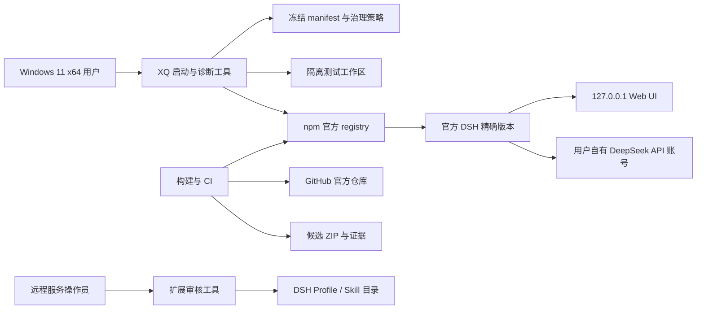
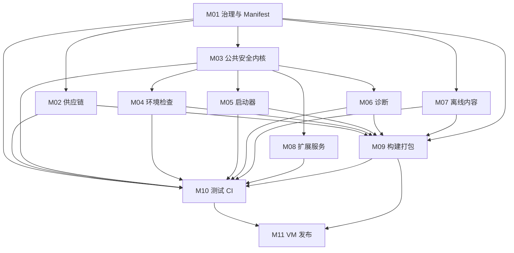

# XQ DSH Windows Kit 总体架构

状态：`ARCHITECTURE-FROZEN`；M01–M11 已形成开发实现基线，外部门禁仍为 `PENDING`
适用产品版本：`1.0.0`
目标上游候选：`@deepseek-ai/dsh@0.1.1-rc.2`
本文定义冻结架构与验收合同。具体实现进度见 `IMPLEMENTATION-M01-M05.md`；CI、VM 与商品发布尚未完成。

## 1. 目标与边界

本项目交付一个可审计的 Windows 11 x64 配置包，使用户可以核验官方 DSH 来源、创建窄范围测试工作区、启动本机 Web UI、完成一次受控任务并生成脱敏诊断报告。

项目不重新打包 DSH，不制作非官方 Desktop 外壳，不保存 API Key，不提供公网服务，不承诺沙箱绝对安全，也不把尚未完成的 VM 验收写成通过。

## 2. 架构原则

1. 安全规则只有一个来源：manifest、governance 和公共 PowerShell 模块。
2. 先验证再执行：包名、版本、registry、host、权限和工作区不满足条件时必须失败关闭。
3. 只读与变更分离：环境检查和诊断不得兼任安装器或修复器。
4. 商品工具与操作员工具分离：¥12.9 自助 ZIP 不包含插件安装执行器。
5. 证据与声明分离：没有证据的门禁只能是 `PENDING`。
6. 上游事实不靠文案硬编码：构建时从官方来源重新观察并与冻结清单比较。
7. 默认拒绝不确定输入：无法确认 CLI 参数、路径边界、插件脚本或监听地址时停止。
8. PowerShell 5.1 是最低脚本兼容目标；开发和 CI 可以额外使用 PowerShell 7。

## 3. 系统上下文



XQ 工具不会把诊断、工作区、会话或凭据发送到 XQ。DSH 与 DeepSeek API 之间的网络行为属于上游 DSH 和用户账号边界，必须在指南中说明。

## 4. 模块划分

| 模块 | 名称 | 核心职责 | 是否进入自助 ZIP |
|---|---|---|---|
| M01 | 治理、Schema 与 Manifest | 产品事实、安全默认值、支持范围、发布状态 | 是，裁剪后的运行清单 |
| M02 | 上游供应链解析与验证 | npm、tarball、SRI、SHA-256、tag、commit、LICENSE | 构建结果进入，工具不进入 |
| M03 | PowerShell 公共安全内核 | 路径、版本、loopback、端口、脱敏、清单校验 | 是 |
| M04 | 只读环境检查器 | Windows、Node、npm、端口、DSH Home、工作区检查 | 是 |
| M05 | 受控启动器 | 精确版本、确认、窄工作区、本机监听、可见进程 | 是 |
| M06 | 只读诊断与二次脱敏 | 最小采集、Profile 检查、Skill/插件枚举、报告 | 是 |
| M07 | 离线中文内容 | 安装、首次任务、权限、FAQ、售后与品牌声明 | 是 |
| M08 | Skill/插件审核与事务化操作 | 静态审核、备份、验证、回滚、删除 | 否，仅源码/操作员验收 |
| M09 | 构建、扫描与打包 | 内容映射、敏感扫描、稳定 ZIP、hash、发布清单 | 只进入生成结果 |
| M10 | 自动化测试与 CI | 单元、契约、负向、制品、供应链、Actions | 否 |
| M11 | Windows VM 验收与发布门禁 | 中英文 VM、E2E、证据索引、发布判定 | 证据摘要进入源码，不进入商品 ZIP |

各模块的详细施工合同位于 `docs/modules/`。

## 5. 依赖关系



M01、M02 和 M03 是基础模块。M05 在上游 Web host 参数得到真实证据前不得进入完成状态。M11 不允许被其他模块自动标记为通过。

## 6. 目标源码结构

```text
xq-dsh-windows-kit/
├── .github/workflows/
├── acceptance/
│   ├── ACCEPTANCE-MATRIX.md
│   ├── evidence-schema.json
│   ├── vm-en/
│   └── vm-zh/
├── build/
├── content/
├── diagnostics/
├── docs/
│   └── modules/
├── extensions/                 # 操作员工具，不进入自助 ZIP
├── governance/
├── launcher/
├── lib/
│   └── XQDSH.Common.psm1
├── LICENSES/
├── manifest/
├── schemas/
├── tests/
├── CHANGELOG.md
└── README.md
```

## 7. 配置与事实来源

### 7.1 `manifest/product-manifest.json`

这是冻结的产品事实，至少包含：

- 产品与 DSH 精确版本；
- npm 包、registry、tarball、integrity 与 SHA-256；
- Git tag、完整 commit、LICENSE URL 与 hash；
- 支持的 OS、Node 范围、默认 host/port；
- 默认 sandbox/approval；
- 遥测状态、发布状态与锁定观察时间。

运行脚本只读取，不修改该文件。

### 7.2 `manifest/trusted-sources.json`

保存允许的 HTTPS 主机、包名、仓库、tag 命名规则和重定向策略。供应链工具不得接受调用者临时传入的任意 registry 来替换信任根。

### 7.3 `governance/*.json`

保存产品范围、扩展服务分类、支持矩阵和发布门禁。治理文件由 JSON Schema 验证，禁止自由文本字段改变安全含义。

### 7.4 两类发布清单

- `product-manifest.json` 放入 ZIP，描述 ZIP 内产品及上游锁。
- `release-manifest.json` 与 ZIP 并列生成，记录 ZIP 自身 hash、大小和构建证据。

ZIP 不能包含自己的 SHA-256，否则形成自引用。

## 8. 关键数据流

### 8.1 构建数据流

```text
冻结 manifest
  → 查询官方 npm/GitHub
  → 下载到隔离 staging
  → 比较 SRI/SHA/tag/commit/LICENSE
  → 渲染离线内容
  → 复制白名单文件
  → 扫描外链与敏感内容
  → 生成稳定排序 ZIP
  → 生成外部 release manifest 和 SHA256SUMS
```

构建 staging、npm cache、下载的 tarball、测试日志和 VM 证据默认不得进入商品 ZIP。

### 8.2 启动数据流

```text
读取 manifest
  → 验证运行安全字段
  → 只读环境检查
  → 解析并验证工作区
  → 显示精确命令和网络行为
  → 用户确认
  → 必要时创建窄目录
  → 从该目录运行精确版本 DSH
  → 核对监听地址
  → 显示 PID、URL 和停止方法
```

host 和 port 在 v1 不允许由普通用户参数覆盖。

### 8.3 诊断数据流

```text
最小白名单采集
  → 字段级清洗
  → 序列化到内存
  → 全文第二次脱敏
  → 再扫描敏感模式
  → 用户指定的本地路径写盘
```

任一脱敏或写盘检查失败，报告不落盘。

## 9. 错误与退出约定

所有 PowerShell 工具使用稳定的错误代码和机器可读 `code`：

- `0`：成功，无阻断项；
- `2`：发现预期的环境或策略阻断项；
- `3`：输入、manifest 或 Schema 无效；
- `4`：外部命令或网络失败；
- `5`：内部未预期错误。

警告不应伪装为成功条件。面向用户的错误不得包含完整命令行凭据、环境变量或未经脱敏的上游输出。

## 10. 发布状态机

```text
draft --自动化和供应链通过--> candidate
candidate --中英文 VM、E2E、人工复核全部有证据--> releasable
任意锁漂移、安全失败或证据撤销------------------> draft
```

代码可以生成状态建议，但不能自行把正式 manifest 改成 `releasable`。发布状态变更需要人工签字记录。

## 11. 已知架构不确定项

以下问题必须在实现前由 M02 形成证据，不能由执行智能体猜测：

1. `0.1.1-rc.2` Web profile 是否提供显式 host 参数，以及参数的准确名称。
2. `workspace-write + ask` 在锁定版本中对应的真实配置字段、默认值和 resolved config 证据。
3. `--dump-config` 在 Profile 缺失时是否会初始化目录。
4. 官方 npm 发布是否提供可绑定 tarball 与 Git commit 的 provenance/gitHead。
5. 精确顶层 `npx` 仍可能按上游 semver 范围解析传递依赖；v1 必须把这一点列为残余风险，除非后续采用经批准的完整依赖锁方案。
6. Windows 沙箱只是部分限制，不得形成“绝对隔离”的产品声明。

## 12. 架构冻结条件

满足以下条件后才能启动 Terra/Luna 编码：

- 11 个模块合同均有输入、输出、依赖和验收 ID；
- 所有跨模块字段有唯一来源；
- M05 的 CLI 参数不确定项已分配给 M02，而不是写入假设；
- 自助 ZIP 与操作员工具边界明确；
- 发布门禁不能被自动化伪造；
- `ACCEPTANCE-MATRIX.md` 覆盖任务书全部自动化与人工验收项；
- Sol 完成一次架构一致性审查，用户确认没有方向性修改。
